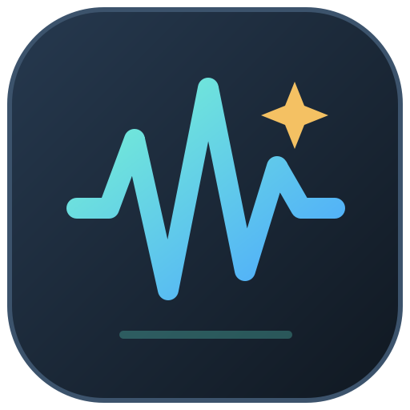
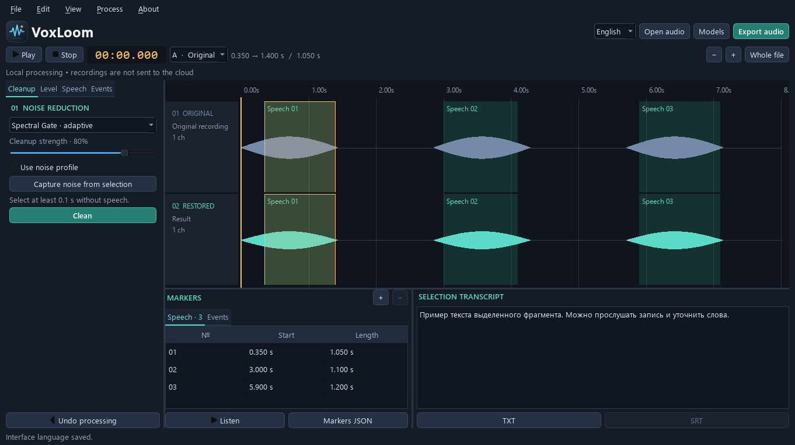

<p align="center">
  
</p>

<h1 align="center">VoxLoom Studio</h1>

<p align="center"><strong>English</strong> | <a href="README.ru.md">Русский</a></p>

<p align="center">
  Restore audio, find speech and transcribe selected passages — on your own computer.
</p>

<p align="center">
  <a href="docs/BUILDING.md">Build the app</a> ·
  <a href="docs/DOWNLOADS.md">Download &amp; install</a> ·
  <a href="#features">Features</a> ·
  <a href="docs/ARCHITECTURE.md">Architecture</a> ·
  <a href="CONTRIBUTING.md">Contribute</a> ·
  <a href="https://github.com/suroviimustang-ai/VoxLoom-Studio/issues">Report a bug</a>
</p>

<p align="center">
  <a href="https://github.com/suroviimustang-ai/VoxLoom-Studio/actions/workflows/ci.yml"></a>
  <a href="LICENSE"></a>
  <a href="docs/BUILDING.md"></a>
</p>



*VoxLoom 0.2.2 at 1366×768. The synthetic waveform and sample text illustrate the
interface, not recognition accuracy. The desktop interface is currently in Russian;
the language links above switch the documentation.*

**Compact apps and separate model packs are distributed through
[GitHub Releases](https://github.com/suroviimustang-ai/VoxLoom-Studio/releases).**
Choose a Windows EXE installer, Linux AppImage or Apple Silicon macOS DMG, then
install the models you need through **Модели → Установить пакет** (Models → Install
pack). See the [download guide](docs/DOWNLOADS.md). Source history contains code and
build instructions; binaries and weights are release assets. After model setup,
audio processing works offline.

| Platform | Build from source | Validation |
| --- | --- | --- |
| Windows 10/11 x64 | [Instructions](docs/BUILDING.md#windows) | Local packaged-app checks and native CI passed |
| macOS 15+ Apple Silicon | [Instructions](docs/BUILDING.md#macos-15-apple-silicon) | Native tests and interface checks passed in CI |
| Ubuntu 24.04 x64 | [Instructions](docs/BUILDING.md#ubuntu-2404-x64) | Native tests and interface checks passed in CI |

See [GitHub Actions](https://github.com/suroviimustang-ai/VoxLoom-Studio/actions)
for current results. CI does not replace installer testing on a clean system.
The [first successful run on November 11, 2026](https://github.com/suroviimustang-ai/VoxLoom-Studio/actions/runs/42965738853)
passed 47 tests and six simulated display configurations on each operating system.

## Features

- Open WAV, FLAC, MP3, OGG, AAC/M4A and other formats through libsndfile/PyAV.
- Keep the original track A intact, process a separate track B, and audition selections.
- Restore speech with Spectral Gate, RNNoise and DeepFilterNet3; filter hum and
  normalize loudness using LUFS or sample peaks.
- Find speech with Silero VAD and sound events with FlexSED + CLAP, with colored regions.
- Transcribe Russian and other languages with Whisper base, small and large-v3-turbo;
  export TXT and SRT.
- Export WAV/FLAC/OGG audio and JSON regions; cancel background processing.
- Start with a splash screen and fit the window to the current monitor's work area,
  accounting for display scaling.
- Use a compact layout without scrolling the whole window: normalization has its
  own tab, and narrow windows switch between regions and text with tabs. Display
  checks cover work areas down to 800×600 logical pixels; long text and lists scroll
  within their own panels.

Compact packages include Python, Qt, audio codecs, RNNoise and Silero VAD.
Spectral Gate and DSP also work immediately. Whisper, DeepFilterNet3 and FlexSED
use optional verified model packs. Once installed, the selected models work without
internet, API keys, a separate Python installation or CUDA. Audio stays local.
The full model-bundled build remains available for users building from source.

## Workflow

The Russian control labels are included below so you can find them in the app.

1. Open a recording with the open button or drag a file into the window.
2. Choose A/B as the input for playback and subsequent processing.
3. In **Очистка** (Clean), choose a method and strength. Capture a noise profile
   from a pause without speech when using profile-based reduction.
4. Use **Речь → Найти речь** (Speech → Find speech), or enter English event prompts
   in **События** (Events), such as `Speech; Conversation; Whispering`. These prompts
   can also find events in recordings containing Russian speech.
5. Select a region or drag over the timeline, listen to it, and transcribe it.
6. Export audio, text or regions. Text edits are saved to TXT; SRT preserves the
   model's original segments with timestamps on the recording's timeline.

Open **Уровень** (Level) for normalization. On short windows, spacing contracts and
additional explanations appear in tooltips. Hover over truncated filenames and
status messages to read them in full.

Space: play/pause · Esc: stop · Ctrl+O: open · Ctrl+S: export audio ·
Ctrl+Z: undo processing · Ctrl+mouse wheel: zoom the timeline.

## Run from source

Download the sources with **Code → Download ZIP**, or clone the repository:

```bash
git clone https://github.com/suroviimustang-ai/VoxLoom-Studio.git
cd VoxLoom-Studio
```

On Windows, with Python 3.11 x64, run these commands in PowerShell from the project
directory. For macOS and Ubuntu, follow the [native build guide](docs/BUILDING.md).

```powershell
py -3.11 -m venv .venv311
.venv311/Scripts/python tools/install_dependencies.py
.venv311/Scripts/python tools/doctor.py
.venv311/Scripts/python tools/prepare_models.py
.venv311/Scripts/python tools/prepare_flexsed.py
./run.ps1
```

Preparation requires a network connection and several gigabytes of disk space.
Whisper revisions and SHA-256 checksums are pinned in `model-sources.json`;
FlexSED/CLAP revisions are pinned in the preparation script. Base is useful for
quick drafts, small offers a balance, and turbo is a larger option. Having a model
available does not guarantee accurate transcription of quiet or damaged speech.

## Checks and packaging

```powershell
.venv311/Scripts/python -m pytest -q
.venv311/Scripts/python tools/check_startup.py
.venv311/Scripts/python tools/build_portable.py
./build.ps1
.venv311/Scripts/python tools/finalize_flexsed_release.py
```

`build_portable.py` creates a native application directory or a macOS `.app`.
The local Windows installer pipeline (`build.ps1`) requires Inno Setup 6 and an
English Windows SAPI voice for its speech fixture. It checks mandatory weights,
DLL imports, the frozen executable, codecs, VAD, denoisers, FlexSED and all three
Whisper models without downloading models at runtime.
Full installer output: `release/VoxLoom-Studio-Setup-0.3.0-Offline-win-x64.exe`.
The same pipeline's portable output is `dist-flexsed/VoxLoom/VoxLoom.exe`;
keep the entire directory.

For compact EXE/AppImage/DMG packages, use `python tools/build_portable.py --compact`
followed by `python tools/package_release.py` on the target OS. See
[build and packaging instructions](docs/BUILDING.md#compact-release-packages).

## Limitations

- Whisper may omit, repeat or invent words. Verify transcripts by listening.
  The absence of an “unintelligible” label is not evidence of accuracy.
- FlexSED detects events; it does not clean audio, transcribe words or identify
  people. Its scores are not calibrated probabilities.
- The app accepts up to eight channels and 1.5 GB of PCM data and processes audio
  in memory. On an 8 GB RAM system, use short selections with large models.
  LUFS normalization supports up to five channels.
- Session history is not saved between launches. Export your work before closing.
  The limiter controls sample peaks; true-peak limiting is not claimed.
- Source and packaging checks are separate workflows. The release pipeline tests
  each native bundle, installs all model packs and checks the installed or mounted
  distribution before publishing it. See the release's reports for its exact commit.
- The Windows executable is not digitally signed. Local checks do not replace
  installation testing in a clean virtual machine.

## License and contributing

Copyright (C) 2026 MatSoftAI and VoxLoom contributors. Application code and original
assets are available under [GPL-3.0-only](LICENSE), without warranty. Use,
modification and redistribution, including commercial use, are allowed subject
to the license. Third-party code and weights retain their respective licenses.

[Components and licenses](THIRD_PARTY_NOTICES.md) · [Architecture](docs/ARCHITECTURE.md) ·
[Contributing](CONTRIBUTING.md) · [Security](SECURITY.md) · [Releases](docs/RELEASING.md) ·
[Changelog](CHANGELOG.md) · [Publishing sources](docs/PUBLISHING.md).

For developers: [Python, PowerShell and configuration standards](docs/CODING_STANDARDS.md).

Repository presentation was inspired by [Nota](https://github.com/nota-daw/nota).
VoxLoom is an independent MatSoftAI application and does not use Nota code or
artwork. VoxLoom dependencies are listed in `THIRD_PARTY_NOTICES.md`.
